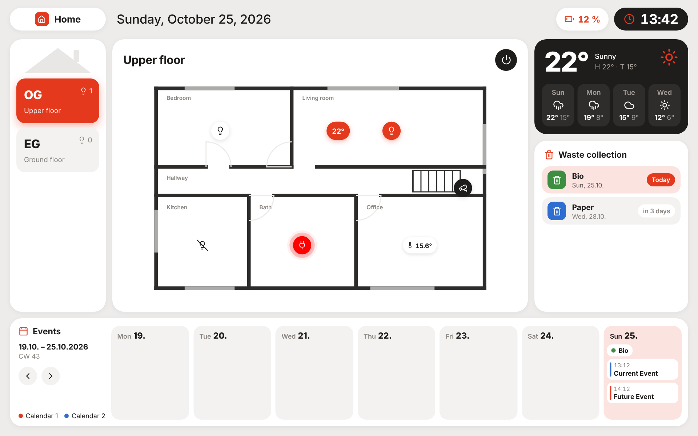
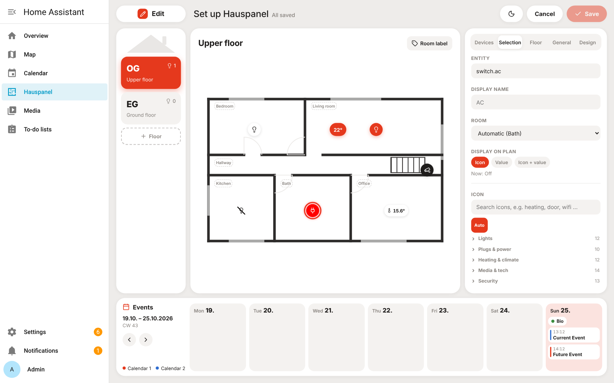
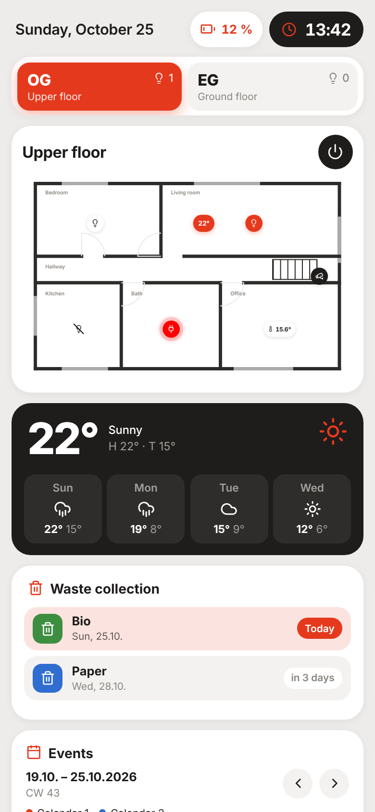

# Hauspanel

[](https://github.com/saschaweiss/ha-hauspanel/actions/workflows/ci.yml)
[](https://github.com/saschaweiss/ha-hauspanel/releases)
[](LICENSE)
[](https://hacs.xyz/docs/faq/custom_repositories)

A floor-plan dashboard for Home Assistant, built for wall-mounted tablets (e.g. Fire HD 10 with Fully Kiosk Browser).
Floors, plans and devices are set up right inside the panel: upload a floor plan, drag your entities onto it, done.



<details><summary>More screenshots: editor and phone layout</summary>





</details>

*Screenshots use the demo layout from the end-to-end tests (Home Assistant demo integration).*

> The user interface is available in German and English and follows your Home Assistant language (German for `de`, English for everything else).

## Features

**Floor plan**
- One plan per floor: SVG (colours adapt to light/dark mode automatically) or JPG/PNG/WebP (optionally inverted at night)
- Room labels and device pins scale with the plan, so they sit in the same spot on every screen
- Power button per floor switches off all devices you marked for it

**Device pins**
- Lights, switches, plugs, climate, sensors, cameras, covers, locks, media players, scenes and scripts
- Show an icon, a value (e.g. temperature) or both; 100+ icons in searchable groups
- Per pin: with or without background (without: off state greyed out and/or struck through), size (50–200 %), mirrored icon, "tap toggles directly" (long-press still opens the popup), colour by on/off state or as a measured value
- Alerts like automation triggers: colour (and optionally blink) a pin when a state is / is not a value or a number is above / below a threshold, optionally for a minimum time – e.g. camera battery below 10 %, or a light on for more than 3 hours
- "State from another entity": colour a pin by a different entity, e.g. a camera pin by its *camera enabled* sensor
- Up to four extra values per popup (e.g. power and energy of a plug)

**Popups**
- Lights: on/off, brightness, colour (hue slider and presets) and white temperature – whatever the light supports
- Climate: target temperature and HVAC mode
- Cameras: live view via Home Assistant's own stream handling (WebRTC/HLS/MJPEG) or a refreshing snapshot, plus a shortcut to HA's camera dialog

**Side panels**
- Weather with 4-day forecast
- Waste collection (works with *Waste Collection Schedule* out of the box)
- Week calendar for any `calendar.*` entities; shows as many entries per day as fit, the rest behind "+N more"
- Calendar range: calendar week, calendar week but "from today" on weekends, or always the next 7 days

**Header**
- Up to four entity values next to the clock, e.g. the tablet's battery level (icon follows level and charging state)

**Look & behaviour**
- Night mode by time or sun position; tap the clock to toggle light/dark for 5 minutes
- Design editor with separate light and night colours, detail colours, shadows, sizes, spacing and layout (column widths, calendar height or hidden)
- Colour picker with hex input, a saved palette and "already used" colours
- Custom CSS for the whole page or a single floor
- Portrait layout for phones and tablets held upright (scrollable, floors as tabs)
- Idle reset: after 2 minutes the panel returns to the start floor and closes popups (also stops forgotten camera streams)

The layout is stored in Home Assistant's `.storage`, so it is part of your HA backups. Changes show up on all tablets immediately.

## Installation

**HACS (recommended)**
1. HACS → ⋮ → *Custom repositories* → add `https://github.com/saschaweiss/ha-hauspanel` as type *Integration*.
2. Download "Hauspanel" and restart Home Assistant.
3. *Settings → Devices & services → Add integration → Hauspanel*.

**Manual:** copy `custom_components/hauspanel` to `/config/custom_components/hauspanel`, restart Home Assistant and add the integration as above.

"Hauspanel" now appears in the sidebar. Updates are offered through HACS whenever a new release is published.

## Setup

As an admin, tap the pencil icon in the panel:

1. **Floor** – add a floor, give it a short code and a name, upload the plan.
2. **Room labels** – add them and drag each one to the top-left corner of its room.
3. **Devices** – search an entity and drag it onto the plan by its handle. Tap a pin to edit name, room, display, icon, colour, size and behaviour.
4. **General** – start floor, weather entity, calendars, waste sensors, night mode, calendar range, start page.
5. **Design** – colours, shadows, sizes and layout. *Preview* shows the result including calendar and weather before you save.
6. **Save.**

Custom CSS (*Design → Edit CSS*) sits on top of the built-in styles and survives updates. If you break the layout, open the panel with `?nocss` (e.g. `/hauspanel?nocss`) to ignore your custom CSS.

### Waste collection sensors

*Waste Collection Schedule* sensors work in any format: states like "in 3 days" / "tomorrow" / "today", the `daysTo` attribute, or upcoming dates in the attributes. Template sensors may report a date (`2026-10-16`, `16.10.2026`) or a number of days (`3`). The editor shows what was detected for each sensor.

Tip: if a pickup disappears on the day itself, check the sensor's *day switch time* in Waste Collection Schedule.

### Light groups

To control several bulbs in one fixture as a single pin, create a light group in Home Assistant (*Settings → Devices & services → Helpers → Group → Light group*) and place the group entity on the plan.

## Start page

The profile setting in Home Assistant only lists dashboards. Under *General → Start page* the buttons "for me" / "for all users" set Hauspanel as the default page directly.

## Wall tablet (Fully Kiosk)

- Start URL: `http://<your-ha-address>:8123/hauspanel?kiosk` – `?kiosk` covers the HA sidebar and hides the edit button.
- Create a separate HA user **without** admin rights for the tablet: it can control devices but not change the layout.
- With the *Fully Kiosk Browser* integration (requires Fully Plus) you can switch the screen on via a motion sensor and read the tablet's battery level, e.g. to charge only between 20 and 80 %.

## AI assistant tools (MCP)

Hauspanel registers tools for AI assistants (e.g. Claude) that Home Assistant's *Model Context Protocol Server* integration exposes. With them an assistant can search entities, place pins and room labels, add floors and change design and CSS.

- The tools change **only the Hauspanel layout** – no device control, no file access, no restarts.
- Every change is backed up first (last 30 states) and can be undone, including changes made in the editor.
- If the editor is open while the layout changes elsewhere, it warns you and refuses to silently overwrite.
- Floor plans are analysed to detect rooms (split at door openings) so pins land in the right room.

**Setup**
1. *Settings → System → Network → Home Assistant URL*: set your external URL (needed for OAuth login).
2. *Settings → Devices & services → Add integration → Model Context Protocol Server* (keep "admin required" enabled).
3. In your AI client add a custom connector with `https://<your-ha-address>/api/mcp/hauspanel` and sign in with an **admin** account. This URL exposes only the Hauspanel tools, not Assist device control.

Tools: `hauspanel_get_config`, `hauspanel_plan_info`, `hauspanel_find_entities`, `hauspanel_set_pins`, `hauspanel_remove_pins`, `hauspanel_set_rooms`, `hauspanel_remove_rooms`, `hauspanel_set_floor`, `hauspanel_remove_floor`, `hauspanel_update_settings`, `hauspanel_list_backups`, `hauspanel_undo`.

## Development

The frontend source is `src/panel.src.js`; the shipped file `custom_components/hauspanel/frontend/hauspanel-panel.js` is generated from it with the used [Lucide](https://lucide.dev) icons embedded (ISC licence). The font is Inter (SIL OFL), served locally.

```
npm ci
npm run build        # writes frontend/hauspanel-panel.js – commit it together with the source
```

### Tests

| Suite | What it covers | Run |
|---|---|---|
| Backend (`tests/`) | setup/unload, config flow, websocket API incl. conflict detection and SVG sanitizing, AI tools incl. undo, floor plan analysis | `pip install -r requirements_test.txt && pytest tests` |
| End-to-end (`e2e/`) | the real panel in Chromium against a throwaway Home Assistant with the demo integration: rendering, toggles, popups, alerts, editor save and conflicts, colour picker, English UI, phone layout | see below |
| Lint | `ruff check .`, built file up to date, versions and changelog consistent, hassfest, HACS validation | CI |

End-to-end tests need Home Assistant in its own venv (Python 3.14):

```
python3.14 -m venv ~/ha && ~/ha/bin/pip install homeassistant
~/ha/bin/pip install $(~/ha/bin/python e2e/ha_requirements.py)
pip install -r e2e/requirements.txt && python -m playwright install chromium
cd e2e && HASS_BIN=~/ha/bin/hass pytest
```

`python e2e/ha_server.py --hass ~/ha/bin/hass` starts the same demo instance on port 8124 for manual testing (user `admin`, password `e2e-pass-123`).

### Releases

CI runs on every push. Bumping the version in `manifest.json` and `const.py` (plus a `CHANGELOG.md` entry) creates a GitHub release automatically – but only after all checks and tests passed.

## License

MIT – see [LICENSE](LICENSE). Bundled: Lucide icons (ISC), Inter font (SIL OFL 1.1).
